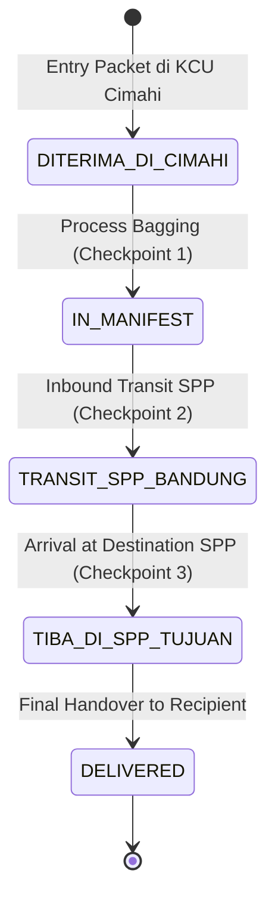

# 📄 Product Requirement Document (PRD)
## Cimahi Origin Delivery System (IPOS5 Redesign)

---

## 📑 Informasi Dokumen
* **Nama Produk:** Cimahi Origin Delivery System (IPOS5 Redesign)
* **Versi Dokumen:** 3.2.0 (Real-Time Analytics, Popular Categories Deep-Dive, Telemetry Simulator, & Responsive Design Update)
* **Status:** Approved / Active
* **Tanggal Pembaruan:** 27 Agustus 2026
* **Target Audience:** Tim Pengembang (Frontend & Backend), Tim Database Administrator, QA Engineer, dan Operational Manager KCU Cimahi / SPP Bandung.

---

## 1. Visi Produk & Ringkasan Eksekutif

### 1.1 Visi Produk
Membangun platform manajemen logistik asal (*origin delivery system*) yang modern, responsif, dan ultra-andal untuk PT Pos Indonesia (KCU Cimahi & SPP Bandung). Sistem ini berfungsi sebagai **Control Tower** operasional logistik yang mengotomatiskan alur pemrosesan kiriman dari pencatatan awal di kantor asal, pembatasan muatan fisik kendaraan (*load partitioning*), pembuatan manifest kontainer, transit di SPP Bandung, hingga serah terima di SPP tujuan akhir, dilengkapi analitik performa real-time dan simulator telemetri.

### 1.2 Tujuan Utama
1. **Load Partitioning & Anti-Overload Armada:** Membatasi muatan fisik armada box (seperti B 9910 PCX) pada batas aman **1.500 kg (100% Utilisasi - SAFE)** dan memisahkan antrean melimpah **12,9 Ton** ke antrean Trip 2 / armada tambahan.
2. **Otomasi Konsolidasi Manifest (Checkpoint Gate Monitoring):** Mengeliminasi pencatatan manual bagging dan mengurangi kesalahan penyusunan manifest via Checkpoint 1, 2, dan 3.
3. **State Machine Linier:** Mengunci transisi status kiriman agar urut (`DITERIMA_DI_CIMAHI` → `IN_MANIFEST` → `TRANSIT_SPP_BANDUNG` → `TIBA_DI_SPP_TUJUAN` → `DELIVERED`).
4. **Analitik Real-Time & Popular Categories Deep-Dive:** Menyajikan dasbor teragregasi langsung dari MongoDB dengan filter rentang waktu presisi, visualisasi tren penjualan, serta modal rincian kategori kiriman yang mendukung *two-way cross filtering*.
5. **Visibilitas Telemetri & Simulator ETA Real-Time:** Menyediakan simulator rute Milk Run dengan penyesuaian kecepatan rata-rata (20/40/80 km/j), kalkulasi waktu bongkar-muat (*dwell time*), dan perkiraan waktu tiba presisi di SPP Bandung.
6. **Stress Testing & Telemetry Dispatch Simulator:** Menyediakan simulator independen untuk injeksi paket massal, pemindai barcode kamera, dan streaming transaksi real-time.
7. **Jaminan Integritas Data (ACID):** Menggunakan MongoDB Session Transactions untuk transaksi pembentukan dan pemrosesan manifest tanpa risiko *partial writes*.
8. **Responsivitas Multi-Perangkat:** Antarmuka responsif penuh (*mobile bottom-sheet*, tablet split-view, touch-scroll data tables) untuk penggunaan di *loading dock* maupun ruang kendali.

---

## 2. Persona Pengguna (*User Personas*)

| Persona | Peran | Tugas & Kebutuhan Utama |
| :--- | :--- | :--- |
| **Operator Counter KCU Cimahi** | Inputter Kiriman | Menerima paket dari pengirim, mencatat nomor resi (`connote_code`), dan menetapkan status awal `DITERIMA_DI_CIMAHI`. |
| **Dispatcher / Manifesting Officer** | Pengelola Bagging & Outbound | Memilih paket-paket individual berstatus `DITERIMA_DI_CIMAHI` untuk digabungkan dalam Manifest Kontainer baru (`IN_MANIFEST`). |
| **Operator Transit SPP Bandung** | Tim Hub Logistik Transit | Melakukan proses scan in / transit massal manifest kontainer yang masuk dari Cimahi (`TRANSIT_SPP_BANDUNG`). |
| **Operator Last-Mile SPP Tujuan** | Receiver & Courier Hub | Memproses kedatangan manifest (`TIBA_DI_SPP_TUJUAN`) dan memperbarui status paket individual menjadi `DELIVERED`. |
| **Super Admin & Supervisor Logistik** | Monitoring & Master Data | Memantau KPI statistik di Dashboard, menganalisis performa produk via modal detail, mengelola master data kantor/rute/jadwal, serta melakukan inspeksi database melalui Compass GUI internal. |

---

## 3. Spesifikasi Kebutuhan Fungsional (*Functional Requirements*)

### 3.1 Modul 1: Dashboard Monitoring & Analytics (`FR-DB-001` hingga `FR-DB-008`)
* **FR-DB-001 (KPI Summaries):** System harus menampilkan 5 kartu KPI real-time: Total Shipments, Active Shipments, Completed, Returned/Failed, serta Nilai Freight (Rp) & Throughput Bobot Kargo (Ton/kg).
* **FR-DB-002 (Linear Status Breakdown):** System menyajikan breakdown jumlah paket berdasarkan status linier tanpa transformasi nama key database.
* **FR-DB-003 (Interactive Period Filter):** System menyediakan filter waktu cepat (*Hari Ini*, *Agustus 2026 Live DB*, *7 Hari Terakhir*, *30 Hari*, *Juli 2026*, *YTD 2026*, serta *Custom Date Range Start & End*).
* **FR-DB-004 (Trend Stacked & Spline Charts):** Grafik batang tumpuk bulanan status kiriman (On Delivery, Delivered, Returned) dan grafik garis spline tren pendapatan serta volume muatan.
* **FR-DB-005 (Popular Categories Widget & Deep-Dive Modal):** Diagram donat SVG adaptif dengan tombol **"See All ↗"** yang membuka **Modal Rincian Komprehensif Popular Categories**. Modal menyediakan KPI ringkasan, diagram donat detail, komparasi pangsa pasar, live search nama layanan, multi-criteria sorting (volume, %, omset, bobot, nama), dan tombol aksi *"Filter Dashboard"* untuk menyaring metrik dashboard secara instan.
* **FR-DB-006 (Av. Check - Nilai per Resi):** Peringkat rata-rata nilai rupiah pendapatan per transaksi resi untuk setiap jenis layanan pos.
* **FR-DB-007 (Av. Delivery Time SLA):** Analisis lead time waktu tempuh pengiriman rata-rata antar regional pos beserta status performa SLA (Perfect, Fine, For too long).
* **FR-DB-008 (Live Connotes Telemetry Stream):** Tabel pemantauan 20 transaksi connote terakhir dari database dengan auto-polling 5 detik, fitur salin resi instan, badge status linier, dan pintasan *Tracking Checker*.

### 3.2 Modul 2: Data Transaksi Kiriman (`FR-TX-001` hingga `FR-TX-004`)
* **FR-TX-001:** System menyediakan pencarian cepat nomor resi (`connote_code`) dan penataan data berhalaman (pagination 25/50/100 baris).
* **FR-TX-002:** Multi-filtering interaktif berdasarkan status linier, jenis layanan, Nopend tujuan, kode regional, dan armada pengirim.
* **FR-TX-003:** Fitur ekspor data transaksi serta modal rincian armada pengangkut dan riwayat audit trail perjalanan.
* **FR-TX-004 (Bulk CSV Import):** Kemampuan mengimpor ribuan data transaksi connote dari file CSV secara terstruktur.

### 3.3 Modul 3: Routing Checker & Audit Trail (`FR-CH-001` hingga `FR-CH-003`)
* **FR-CH-001:** Kolom pencarian nomor resi (`connote_code`) dengan penanganan error state jika resi tidak terdaftar.
* **FR-CH-002:** Visualisasi alur rute pengiriman dari Kantor Asal (contoh: KCP Cililin) menuju SPP Bandung hingga SPP Tujuan Akhir.
* **FR-CH-003:** **Tabel Audit Trail (Riwayat Perjalanan)** yang merekam jejak perjalanan kronologis paket berdasarkan array `tracking_history`.

### 3.4 Modul 4: Manajemen Master Data (`FR-MD-001` hingga `FR-MD-006`)
* **FR-MD-001 (Master Kantor):** CRUD data kantor pos (>13.000 data Nopend legacy) dengan pagination dan filter status `AKTIF`/`NONAKTIF`.
* **FR-MD-002 (Master Layanan/Produk):** Pengelolaan katalog layanan Pos Indonesia (Pos Nextday, Reguler, Sameday, Jumbo Cargo, dll).
* **FR-MD-003 (Master Kendaraan):** Pencatatan nopol, jenis kendaraan, dan kapasitas muat armada logistik.
* **FR-MD-004 (Master Rute):** Pemetaan rute asal-tujuan dengan autocomplete Nopend kantor pos otomatis.
* **FR-MD-005 (Jadwal Pick Up SPP):** Monitoring rute pickup berkala SPP Bandung, estimasi ETA di tiap perhentian, serta opsi penyembunyian stop yang di-skip.
* **FR-MD-006 (Template & Penjadwalan):** Pengaturan template mingguan dan auto-generation jadwal bulanan armada.

### 3.5 Modul 5: Telemetri & Simulator Milk Run (`FR-MR-001` hingga `FR-MR-003`)
* **FR-MR-001 (Milk Run Telemetry & Load Partitioning):** Visualisasi pergerakan waypoint, status perhentian (Waiting/Skipped/Completed), serta pembatasan kapasitas muatan fisik aktif **1.500 kg** dengan pengalihan sisa tonase ke **Overspill Queue**.
* **FR-MR-002 (Milk Run Simulator):** Simulator rute interaktif dengan kalkulasi ETA presisi berdasarkan slider kecepatan (20/40/80 km/j), waktu muat (*dwell time*), dan jam berangkat.
* **FR-MR-003 (Skipped Stop Handling):** Mengabaikan perhentian kosong (*skipped stop*) secara otomatis tanpa memutus rantai rute perjalanan.

### 3.6 Modul 6: Transit & Gate Monitoring System (`FR-GM-001` hingga `FR-GM-004`)
* **FR-GM-001 (Checkpoint 1 - Bagging & Manifesting):** Pemilihan paket berstatus `DITERIMA_DI_CIMAHI` untuk dibungkus ke manifest kontainer baru (`MNFXXXXXX`). Status berubah menjadi `IN_MANIFEST`.
* **FR-GM-002 (Checkpoint 2 - Inbound Transit SPP Bandung):** Pemindaian manifest kontainer untuk mengubah seluruh resi di dalamnya menjadi status `TRANSIT_SPP_BANDUNG`.
* **FR-GM-003 (Checkpoint 3 - Arrival & Last-Mile Delivery):** Penerimaan kedatangan di SPP tujuan (`TIBA_DI_SPP_TUJUAN`) dan penyelesaian pengiriman paket individual menjadi `DELIVERED`.
* **FR-GM-004 (ACID Transaction Rule):** Seluruh operasi perubahan status manifest wajib dibungkus dalam MongoDB Session Transactions.

### 3.7 Modul 7: Telemetry Simulator (`FR-SIM-001` hingga `FR-SIM-003`)
* **FR-SIM-001 (Live Stream Injector):** Menginjeksi paket kiriman baru secara otomatis ke MongoDB pada interval waktu tertentu untuk simulasi beban live.
* **FR-SIM-002 (Barcode Scanner Component):** Modul pemindaian barcode resi via kamera perangkat atau input barcode manual.
* **FR-SIM-003 (Bulk Injector):** Pembuatan dan injeksi ratusan/ribuan data transaksi connote secara simultan untuk pengujian performa.

### 3.8 Modul 8: Otentikasi, RBAC & Administrasi Sistem (`FR-SYS-001` hingga `FR-SYS-004`)
* **FR-SYS-001 (Auth & RBAC):** Autentikasi sesi aman dengan pembedaan peran (*Operator Counter*, *Dispatcher*, *Operational Supervisor*, *Super Admin*).
* **FR-SYS-002 (Compass GUI - Restricted):** Antarmuka GUI penjelajah database MongoDB internal (Khusus Super Admin).
* **FR-SYS-003 (Settings Connection - Restricted):** Pengubahan dinamis koneksi string URI MongoDB di runtime (Khusus Super Admin).
* **FR-SYS-004 (User Profile & Audit Trail):** Manajemen profil pengguna dan riwayat log aktivitas operasional.

---

## 4. Kebutuhan Non-Fungsional (*Non-Functional Requirements*)

### 4.1 Performa & Responsivitas (`NFR-PERF`)
* **Waktu Respon API:** < 200ms untuk query agregasi standar dan < 500ms untuk transaksi multi-document manifest.
* **Waktu Muat SPA:** Initial Page Load < 1.5 detik menggunakan Vite bundle optimization.
* **Auto-Polling Telemetri:** Sinkronisasi latar belakang setiap 5 detik tanpa menyebabkan *flicker* atau gangguan pada interaksi pengguna.

### 4.2 Integritas Data & Keamanan (`NFR-SEC`)
* **Atomisitas Transaksi (ACID):** Transaksi bagging dan transit tidak boleh meninggalkan state *half-updated* (full rollback jika terjadi kegagalan).
* **Keamanan Akses & RBAC:** Seluruh endpoint API sensitif memvalidasi token sesi pengguna. Sesi otomatis kadaluarsa setelah 60 menit inaktivitas. Password di-hash menggunakan bcrypt.
* **Validasi Input Backend:** Validasi format Nopend, Connote Code, dan Master Manifest Code di layer controller Express.

### 4.3 Desain Antarmuka & UX Responsif (`NFR-UX`)
* **Navy Premium Design System:** Konsistensi warna Dark Navy, glowing cyan accent, dan komponen glassmorphic modern.
* **Multi-Tier Responsiveness:** Tata letak adaptif penuh pada Desktop (>1440px), Laptop (1025-1366px), Tablet (769-1024px), dan Smartphone (<=768px). Modal menggunakan mode *bottom-sheet* fluid pada mobile dengan tabel *touch-scroll*.

---

## 5. State Machine Linier Transisi Status Paket

---

## 6. Kriteria Penerimaan (*Acceptance Criteria*)

1. **AC-01 (Manifest Creation):** Ketika operator membuat manifest dengan 5 resi berstatus `DITERIMA_DI_CIMAHI`, 1 dokumen manifest terbentuk di koleksi `manifests` dan 5 resi di `transaksi` berubah menjadi `IN_MANIFEST` dalam 1 transaksi ACID.
2. **AC-02 (Invalid Transition Prevention):** Permohonan perubahan status yang melompati state machine linier wajib ditolak dengan HTTP 400 Bad Request.
3. **AC-03 (Audit Trail Accuracy):** Setiap perubahan status menambahkan entri riwayat pada array `tracking_history` dengan timestamp milidetik presisi.
4. **AC-04 (Popular Categories Modal Interactivity):** Menekan tombol *See All* pada Popular Categories wajib membuka modal detail komprehensif, menampilkan metrik KPI kategori, mendukung filter pencarian dan sorting, serta memicu filter dashboard utama via tombol *Filter Dashboard*.
5. **AC-05 (Mobile Responsiveness):** Seluruh halaman dan modal wajib dapat dioperasikan secara penuh pada layar smartphone (<= 768px) tanpa terpotong (*no clipping*) dan tabel dapat di-scroll horizontal secara lancar.

---
*© PT Pos Indonesia - PRD Cimahi Origin Delivery System*
